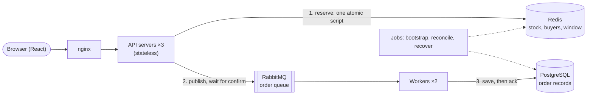

# Flash Sale

A flash sale for one product with limited stock, a configurable time window and one item per user, built to stay correct when thousands of people press "Buy" in the same second.

- **No overselling** and **one item per user**, decided in one atomic step in Redis.
- **"You got it" is never lost.** The user is told only after RabbitMQ has confirmed it stored the order. Workers then save it in PostgreSQL.
- **Proven under load and failure.** 10,000 users at once sell exactly the stock, and the checks still pass while servers are killed, PostgreSQL is stopped or Redis loses all its data.

Stack: Node.js 24 and TypeScript (Fastify), React, Redis, RabbitMQ, PostgreSQL, nginx, Docker Compose.

## Quick start

You need Docker with Compose v2.

```bash
docker compose up --build -d --wait
```

Open **http://localhost:8080**. On the first start, the sale opens 30 seconds after start-up, runs for an hour and has 100 units. The first build downloads the dependencies and takes a few minutes.

| Task                                     | Command                                                                         |
| ---------------------------------------- | ------------------------------------------------------------------------------- |
| Restart the sale (full stock, new times) | `docker compose run --rm jobs reset --stock 100 --starts-in 10 --duration 3600` |
| RabbitMQ dashboard                       | http://localhost:15672 (user `flash`, password `flash`)                         |
| Logs                                     | `docker compose logs -f api worker`                                             |
| Stop                                     | `docker compose down` (add `-v` to delete the data)                             |

The sale's settings come from `SALE_TOTAL_STOCK`, `SALE_START_DELAY_SECONDS`, `SALE_DURATION_SECONDS`, or absolute `SALE_STARTS_AT` / `SALE_ENDS_AT` (ISO 8601). They apply when the sale is first created; `reset` changes them later.

## How it works



1. **nginx** serves the React app and spreads API requests over three identical API servers.
2. **A Lua script in Redis decides each purchase** in one step that nothing can interrupt. It checks whether this user already bought, checks the sale window against Redis's own clock, checks the stock, then takes a unit and records the buyer.
3. **The API publishes the order to RabbitMQ** (a quorum queue) and waits for the publisher confirm.
4. **Only then does the user get `201 purchased`.** Buying again returns the same order, so retries are safe.
5. **Workers save orders into PostgreSQL** in batches. Saving is idempotent, a unique constraint allows one order per user, and a `CHECK` on the sold count is a last guard against overselling.

**Redis decides; RabbitMQ and PostgreSQL record.** The database is never on the request path, so the sale keeps selling when PostgreSQL is down, and the workers catch up afterwards. If Redis loses its data, a recovery job pauses the sale, waits for the queue to drain, rebuilds Redis from PostgreSQL and resumes.

The full design is in [docs/](docs/README.md). Twelve short documents cover the purchase flow, data model, consistency and recovery, every failure scenario, and the production setup.

## Design choices and trade-offs

| Choice                                                                        | Why                                                                                                          | Trade-off                                                                                                                                                            |
| ----------------------------------------------------------------------------- | ------------------------------------------------------------------------------------------------------------ | -------------------------------------------------------------------------------------------------------------------------------------------------------------------- |
| **A Redis script decides each purchase**                                      | Atomic and in memory: no locks, no race between "check stock" and "take one"                                 | During the sale, Redis holds the truth. It needs durability (below) and a recovery procedure                                                                         |
| **RabbitMQ with publisher confirms before answering**                         | A second durable copy exists before the user hears "you got it", even if Redis dies a moment later           | One more component. If RabbitMQ is down, purchases answer `503` until it is back (rare: a cluster in production)                                                     |
| **PostgreSQL off the request path**                                           | A slow or failed database does not slow or stop the sale                                                     | Order records are eventually consistent, typically a few milliseconds behind                                                                                         |
| **Reservations are completed, never cancelled**                               | When a confirm is lost, cancelling could free a unit that is actually sold                                   | A reservation whose publish failed waits for the user's retry or for reconciliation at the end of the sale                                                           |
| **Redis `appendfsync always`**                                                | A Redis restart loses nothing, so no recovery is needed after it. Only winners write, at most `stock` writes | Slower writes in theory. Measured: no difference here, even with every user writing (see the stress test)                                                            |
| **One clock: Redis `TIME`**                                                   | API servers' clocks drift; the window is the same for every request                                          | The "not started yet" shortcut uses each server's clock, so a server running behind delays the opening by its error (milliseconds with NTP). It can never open early |
| **The clock opens and closes the sale**                                       | Checked on every request, so no scheduled job can be late or fail to switch it                               | Reconciliation still needs a scheduler at `endsAt` (EventBridge in production, the `scheduler` service locally)                                                      |
| **Separate apps per role in one repository** (api, worker, jobs, web, shared) | Each scales and deploys on its own; the API never touches PostgreSQL, the worker never touches Redis         | More entry points than a single server; they share one package for the message contract and key names                                                                |
| **Status by polling** (every 2 s, cached for 0.5 s)                           | Simple, cache-friendly, and good enough for a countdown                                                      | Up to a few seconds of delay on the stock shown; the purchase answer itself is always exact                                                                          |
| **Fail fast**                                                                 | Unreachable Redis or RabbitMQ gives an immediate `503`, and an overloaded server sheds load                  | Users see "try again" instead of waiting                                                                                                                             |

**Not built, on purpose:** login, payment, several sales at once, and bot protection or rate limiting. Users type a username or email; "purchased" means a unit is reserved for them. More in [Decisions](docs/07-decisions.md).

## API

| Endpoint                         | Returns                                                                                                                                                                     |
| -------------------------------- | --------------------------------------------------------------------------------------------------------------------------------------------------------------------------- |
| `GET /api/sale`                  | Status (`upcoming`, `active`, `sold_out`, `ended`, `paused`), window, total and remaining stock, server time                                                                |
| `POST /api/purchases` `{userId}` | `201 purchased` with the order · `409 already_purchased` (same order) · `409 sold_out`, `sale_not_started`, `sale_ended` · `400 invalid_user_id` · `503` with `Retry-After` |
| `GET /api/purchases/:userId`     | `{ purchased: true, order }` or `{ purchased: false }`                                                                                                                      |

User IDs are normalised, so `Alice@Mail.com ` and `alice@mail.com` are the same user. Details: [API](docs/05-api.md).

## Project layout

```
apps/
  api/        Fastify HTTP API: decides in Redis, publishes to RabbitMQ
  worker/     RabbitMQ consumer that saves orders in PostgreSQL
  jobs/       bootstrap, reconcile, recover, reset, and the local scheduler
  web/        React app, plus the nginx config
packages/
  shared/     Order message format, Redis keys, PostgreSQL schema, clients, config
tools/
  stress/     Stress and chaos tests
infra/aws/    Production infrastructure as code: a commented design, not deployed
docs/         Design documents
```

Inside each backend app, use cases talk to the outside world through small interfaces (`app`), implemented by `adapters` for Redis, RabbitMQ and HTTP; the API's pure rules live in `domain`. Business outcomes such as "sold out" are return values; only infrastructure failures throw. See [Code structure](docs/11-code-structure.md).

## Development

You need Node.js 22.12 or newer (24 recommended, see `.nvmrc`) and Docker.

```bash
npm ci
npm run infra:up                              # only Redis, RabbitMQ and PostgreSQL
npm run jobs -w @flash-sale/jobs -- bootstrap # tables, the sale, the queues, Redis in sync
npm run dev -w @flash-sale/api                # http://localhost:3000
npm run dev -w @flash-sale/worker
npm run dev -w @flash-sale/web                # http://localhost:5173
```

## Tests

```bash
npm test                  # unit tests, no infrastructure needed
npm run infra:up
npm run test:integration  # against real Redis, RabbitMQ and PostgreSQL (a separate test database)
npm run lint && npm run typecheck
```

| Level       | Tests | Highlights                                                                                                                                                                                                                                                                                                           |
| ----------- | ----- | -------------------------------------------------------------------------------------------------------------------------------------------------------------------------------------------------------------------------------------------------------------------------------------------------------------------- |
| Unit        | 146   | Purchase rules, user ID normalisation, HTTP status codes, the shared contract test for both sale stores, the worker's de-duplication, recovery timing, every message the web app shows                                                                                                                               |
| Integration | 34    | A naive "read, then decrement" version oversells under concurrency and the script does not; 300 concurrent HTTP buyers for 10 units get exactly 10 `201`s; a failed publish is completed on retry; the worker retries through a database outage and dead-letters bad data; recovery waits for orders still in flight |

## Stress test

```bash
npm run stress
```

One command builds and starts the whole system, resets the sale, and has **10,000 users press "Buy" the moment it opens** (10% of them twice) through nginx. The load comes from a container inside the Docker network. Afterwards it waits for the workers, then **checks Redis, PostgreSQL and RabbitMQ directly** instead of trusting the API's answers. It exits with code 1 if any check fails.

Options: `--users`, `--stock`, `--connections`, `--double-click`, `--chaos <fault>`. For example: `npm run stress -- --users 20000 --stock 500`. See [Testing](docs/09-testing.md).

**Expected outcome:** exactly `min(stock, users)` users get `201`, everyone else gets `409 sold_out` (or `already_purchased` on a second click), and all eight checks pass:

```
Responses: 11,000 requests in 3.88 s = 2,836 requests/s
  201 purchased              100
  409 already_purchased       10
  409 sold_out            10,890
Latency: p50 162 ms · p95 273 ms · p99 313 ms · max 365 ms

Checks
  ✓ Exactly min(stock, users) units sold: 100 orders, expected 100
  ✓ At most one order per user: 100 users hold 100 orders; 0 users were given two different orders
  ✓ remainingStock + buyers = totalStock: 0 + 100 = 100, totalStock 100
  ✓ Every "you got it" answer has its order in PostgreSQL: 100 users were told they have an item; 0 of them have no matching order
  ✓ Redis buyers and PostgreSQL orders match: 100 buyers in Redis, 100 orders in PostgreSQL, 0 differ
  ✓ sold_count matches the order rows: sold_count 100, 100 rows
  ✓ Every order falls inside the sale window: 0 orders outside the window
  ✓ Order queue drained, dead-letter queue empty: 0 waiting, 0 dead-lettered

PASSED (8/8 checks)
```

### Results

Measured on one laptop: a 4-core Intel Core i7 (8 threads) with Docker Desktop on macOS, its VM given 8 CPUs and 8 GB. The load generator, nginx, three API servers, two workers, Redis, RabbitMQ and PostgreSQL all share its CPU, so the numbers show relative behaviour, not a capacity promise. 10,000 users and 500 connections in every run.

| Run                                       | Redis fsync | Throughput        | p50        | p99        | Checks |
| ----------------------------------------- | ----------- | ----------------- | ---------- | ---------- | ------ |
| Stock 100                                 | `always`    | 2,512–2,836 req/s | 162 ms     | 313–466 ms | 8/8    |
| Stock 100                                 | `everysec`  | 3,043 req/s       | 138 ms     | 325 ms     | 8/8    |
| Stock 10,000 (every user writes to Redis) | `always`    | 2,402–2,983 req/s | 152–191 ms | 303–348 ms | 8/8    |
| Stock 10,000 (every user writes to Redis) | `everysec`  | 2,008–2,304 req/s | 191–220 ms | 410–464 ms | 8/8    |

**`appendfsync always` costs nothing measurable here,** even when every request writes. The spread between two runs of the same setting is larger than the gap between the settings. Two caveats: the bottleneck here is shared CPU, not Redis; and fsync on Docker Desktop's virtual disk may be cheaper than on a server's disk. Run it yourself with `REDIS_APPENDFSYNC=everysec npm run stress`; the next plain run switches back.

### Chaos runs

`npm run stress -- --chaos <fault>` injects a fault one second after the opening, with 10,000 users and 5,000 units, so that units are still selling when it hits. Every check still has to pass.

| `--chaos`       | Fault                                                             | What happened                                                                                                                                                                                                | Checks |
| --------------- | ----------------------------------------------------------------- | ------------------------------------------------------------------------------------------------------------------------------------------------------------------------------------------------------------ | ------ |
| `kill-api`      | An API server's process is killed; Docker restarts it             | No user saw an error. nginx retried the cut-off requests on another server. Two of them had already reserved a unit, so their retry answered `already_purchased` with that order: 4,998 `201`s, 5,000 orders | 8/8    |
| `kill-worker`   | A worker's process is killed while it holds unacknowledged orders | RabbitMQ redelivered its orders to the other worker, which skipped the ones already saved                                                                                                                    | 8/8    |
| `stop-postgres` | PostgreSQL is stopped for 10 s                                    | All 5,000 units sold while it was down. The workers waited and caught up when it came back                                                                                                                   | 8/8    |
| `restart-redis` | Redis is killed and started again, down for about 4 s             | 2,799 immediate `503`s while it was down. Its append-only file restored every reservation, and selling resumed at once                                                                                       | 8/8    |
| `wipe-redis`    | Redis loses all its data; the `recover` job runs                  | `503 sale_not_initialized`, then `503 sale_paused` for about 8 s while recovery drained the queue and rebuilt Redis from PostgreSQL. Selling resumed and the 5,000 units sold without an oversell            | 8/8    |

## Production

The assignment does not ask for a cloud deployment, so none was made. [Cloud deployment](docs/12-cloud-deployment.md) describes how it would run on AWS, and [`infra/aws/`](infra/aws) holds a commented AWS CDK design of it:

- the API on ECS Fargate behind a load balancer, scaled out 10 minutes before each sale;
- the worker on Lambda, fed by Amazon MQ, with bounded concurrency;
- Redis as MemoryDB, RabbitMQ as an Amazon MQ cluster, PostgreSQL as RDS Multi-AZ behind RDS Proxy;
- the React app on S3 and CloudFront;
- EventBridge Scheduler for the bootstrap 10 minutes before the sale and reconciliation at `endsAt`.
