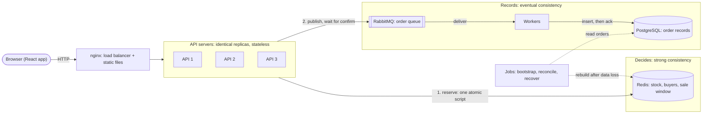

# 2. Architecture

> **In short:** a load balancer spreads requests over identical, stateless API servers. Redis decides every purchase in one atomic step. The API then hands each successful order to RabbitMQ and waits until it confirms the order is stored safely, and only then answers the user. In the background, workers save the orders into PostgreSQL.

## System diagram

## Components

| Component                            | Job                                                                                                                | Keeps state? |
| ------------------------------------ | ------------------------------------------------------------------------------------------------------------------ | ------------ |
| React app                            | Shows the status and countdown, sends the purchase, shows the result                                               | No           |
| nginx                                | Serves the React files and spreads API requests over the servers                                                   | No           |
| API server (Fastify)                 | Validates input, reserves the unit in Redis, hands the order to RabbitMQ, answers the user                         | No           |
| Redis                                | Decides purchases. It holds the remaining stock, who bought, and the sale window                                   | **Yes**      |
| RabbitMQ                             | Keeps each new order safe until a worker has saved it                                                              | **Yes**      |
| Worker                               | Takes orders from RabbitMQ and saves them in PostgreSQL                                                            | No           |
| PostgreSQL                           | Keeps the permanent order records                                                                                  | **Yes**      |
| Jobs (bootstrap, reconcile, recover) | Prepare Redis from PostgreSQL before the sale, complete unfinished reservations, and rebuild Redis after data loss | No           |

## Two zones: one decides, one records

| Zone        | Parts                          | Consistency                                             | Why                                |
| ----------- | ------------------------------ | ------------------------------------------------------- | ---------------------------------- |
| **Decides** | Redis                          | Strong: every decision sees the latest stock and buyers | Stale data would oversell          |
| **Records** | RabbitMQ → worker → PostgreSQL | Eventual: PostgreSQL is a few milliseconds behind       | No purchase decision ever reads it |

The details are in [Consistency and recovery](06-consistency-and-recovery.md).

## Separate apps, not microservices

The repository has one app for each role. Each app is deployed and scaled on its own. "Three API servers" means three identical copies (replicas) of the API app behind the load balancer.

| App      | Copies in the local demo | Triggered by                        | Job                                          |
| -------- | ------------------------ | ----------------------------------- | -------------------------------------------- |
| `api`    | 3                        | HTTP requests                       | Serve the sale status, purchases and lookups |
| `worker` | 2                        | Messages in RabbitMQ                | Save orders to PostgreSQL                    |
| `jobs`   | Runs once, then exits    | Start-up, a schedule or an operator | Bootstrap, reconcile, recover                |
| `web`    | 1                        | Browsers                            | The React app                                |

**This is not microservices.** The apps are split by **role and runtime**, not by business domain. They share one Redis, one database and one small shared package with the domain rules and the order message format. Splitting the sale by domain (a stock service, an order service, a user service) would put the stock check and the order creation in different places, which makes them hard to keep atomic. It would also add network hops and more moving parts. The code layout is described in [Code structure](11-code-structure.md).

## Why this shape

- **Stateless API servers scale out.** Any server can handle any request because shared state lives in Redis. More traffic means adding more servers.
- **Redis decides purchases.** We need one place that puts purchase decisions in a strict order, and does it fast. Redis runs our script as a single step and can run tens of thousands of them per second on one node.
- **PostgreSQL stays off the request path.** If every request wrote to the database, the database would become the bottleneck. Only successful purchases are saved (at most `stock` of them), in the background and in batches.
- **Overload fails fast.** An overloaded server answers `503` with `Retry-After: 1` right away instead of making everyone wait.

## Which request touches what

| Request                                       | Goes through                                    | Waits for                                   |
| --------------------------------------------- | ----------------------------------------------- | ------------------------------------------- |
| Sale status (`GET /api/sale`)                 | nginx → API → cache (at most 0.5 s old) → Redis | Redis, at most twice a second per server    |
| Buy (`POST /api/purchases`)                   | nginx → API → Redis → RabbitMQ                  | The Redis decision and the RabbitMQ confirm |
| Did I get one? (`GET /api/purchases/:userId`) | nginx → API → Redis                             | Redis                                       |
| Save an order                                 | RabbitMQ → worker → PostgreSQL                  | Nothing; it happens in the background       |

## Scaling further (not built)

- Serve the sale status from a CDN. The API already sends `Cache-Control: max-age=1`.
- Put a virtual waiting room in front of the sale for extreme spikes.
- Once the item is sold out, let each API server answer "sold out" from memory instead of asking Redis.
- Spread many sales over a Redis Cluster. All keys of one sale share a hash tag, so they stay on the same node.

---

Previous: [1. Overview](01-overview.md) · Next: [3. Purchase flow](03-purchase-flow.md)
