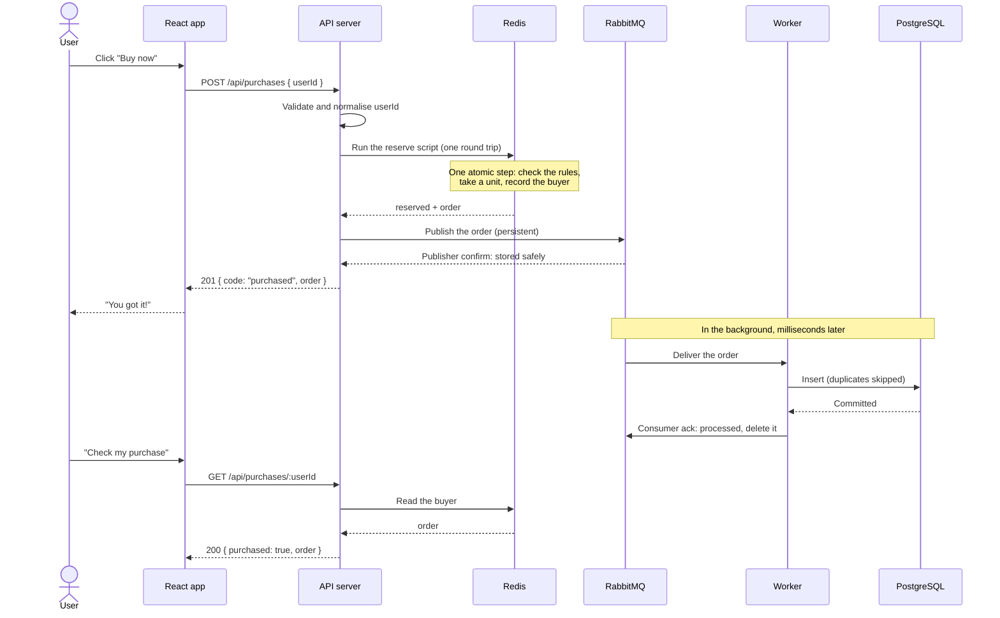

# 3. Purchase flow

> **In short:** Redis decides each purchase with a small script that runs as one uninterruptible step. If every rule passes, the script takes a unit and records the buyer. The API then hands the order to RabbitMQ and waits until RabbitMQ confirms it is stored safely. Only then is the user told "you got it". A worker saves the order into PostgreSQL afterwards.

## Sequence



The user is answered **before** the order reaches PostgreSQL. "Check my purchase" reads Redis, so the user never notices that PostgreSQL is a few milliseconds behind.

## The rules, in order

The script checks these in this exact order. The first one that applies decides the answer.

| #   | Check                            | Answer                                                                                       | HTTP      |
| --- | -------------------------------- | -------------------------------------------------------------------------------------------- | --------- |
| –   | Is the sale missing from Redis?  | `sale_not_initialized`: Redis is empty, because bootstrap has not run or Redis lost its data | 503       |
| 0   | Is the sale paused for recovery? | `sale_paused`                                                                                | 503       |
| 1   | Has this user already bought?    | `already_purchased`, with their original order                                               | 409       |
| 2   | Is it before `startsAt`?         | `sale_not_started`                                                                           | 409       |
| 3   | Is it at or after `endsAt`?      | `sale_ended`                                                                                 | 409       |
| 4   | Is the stock 0?                  | `sold_out`                                                                                   | 409       |
| 5   | Otherwise                        | Reserved: take one unit and record the buyer                                                 | See below |

After a reservation, the API publishes the order to RabbitMQ:

| RabbitMQ's answer                            | What the user gets                                                                                                                 |
| -------------------------------------------- | ---------------------------------------------------------------------------------------------------------------------------------- |
| Publisher confirm                            | `201 purchased`, with the order                                                                                                    |
| No confirm (an error, or nothing within 2 s) | `503 service_unavailable`: "the outcome is unknown, check your purchase". The reservation stays and is completed later (see below) |

- **Why "already bought" comes first:** it makes retries safe. If a user's first request succeeded but the response got lost, a retry returns their original order. It never hands out a second unit.
- **Time comes from Redis**, not from the API servers. A server with a wrong clock cannot open the sale early or keep it open late. The one exception is the shortcut before the opening, described below.

## Why it cannot oversell

Redis runs one script at a time, from start to finish. Nothing can happen between "check the stock" and "take a unit".

Compare a naive version that uses two separate commands:

```text
stock = GET remainingStock     ← 500 requests all read "1" ...
if stock > 0:
    DECR remainingStock        ← ... so all 500 take "the last unit"
```

The integration tests run this naive version next to the real script, under the same load, to show the difference. See [Testing](09-testing.md).

## The script, in plain words

```text
if the sale does not exist          → return "not_initialized"
if the sale is paused               → return "paused"
if buyers already contains userId   → return "already_purchased" + that order
now = Redis server time
if now < startsAt                   → return "not_started"
if now >= endsAt                    → return "ended"
if remainingStock == 0              → return "sold_out"

remainingStock = remainingStock - 1
buyers[userId] = new order
return "reserved" + new order
```

A losing attempt only reads data. Only winners write, so there are at most `stock` writes in the whole sale.

## Script vs worker

|               | Script                               | Worker                                    |
| ------------- | ------------------------------------ | ----------------------------------------- |
| What it is    | About 20 lines of Lua                | A Node.js process                         |
| Where it runs | Inside Redis                         | Outside Redis, as its own process         |
| When it runs  | On every purchase request            | Continuously, in the background           |
| Job           | Decide: check the rules, take a unit | Save orders from RabbitMQ into PostgreSQL |

Redis executes commands one at a time on a single thread, and a script counts as one command: while it runs, nothing else runs. That is what makes it atomic, much like a stored procedure in a database.

## Two kinds of acknowledgement

|                   | Direction         | Meaning                         | When                                |
| ----------------- | ----------------- | ------------------------------- | ----------------------------------- |
| Publisher confirm | RabbitMQ → API    | "Your message is stored safely" | Before the user is answered         |
| Consumer ack      | Worker → RabbitMQ | "Processed, you can delete it"  | After the PostgreSQL insert commits |

The user's answer waits only for the first one.

## Completing a reservation that was never confirmed

Sometimes a reservation exists without a confirmed message: the API crashed between the two steps, or RabbitMQ did not answer. **We never cancel such a reservation.** We cannot know whether RabbitMQ received the message (perhaps only its confirm was lost), so cancelling could sell the unit twice. Instead we complete it:

- **When the user tries again,** rule 1 answers `already_purchased`. The API publishes the order again and answers once it is confirmed.
- **When the sale ends** (and whenever the bootstrap job runs), a reconciliation step publishes every buyer in Redis who has no order record in PostgreSQL.

Duplicates are harmless, because the worker skips orders it has already saved.

## Shortcut before the sale opens

Before `startsAt` nobody can own an order. The API therefore answers `sale_not_started` from its cached copy of the sale (refreshed every 0.5 s) without asking Redis. This absorbs the button-mashing before opening.

This shortcut compares `startsAt` with the API server's own clock. A server whose clock runs behind keeps answering `sale_not_started` for as long as its clock is off. It can never open the sale early or keep it open late, because those answers always come from Redis. Servers keep their clocks in sync (NTP, or Amazon Time Sync in production), so the delay is a few milliseconds at most.

## Saving orders (worker)

1. Receive a batch of orders from RabbitMQ (up to 100, or whatever arrived within 50 ms).
2. Save them with one SQL statement. It inserts the new orders, skips duplicates, and raises the sale's `sold_count` by the number inserted.
3. Acknowledge them after the commit.

**When something goes wrong:**

- **PostgreSQL is down:** the worker keeps the batch and retries it with growing delays, up to 10 s apart. The messages stay unacknowledged in RabbitMQ. Sending them back instead would use up their delivery limit within seconds, and good orders would end in the dead-letter queue only because the database was briefly down.
- **The data is refused:** for example an unreadable message, or an order that would push `sold_count` over the stock. The worker splits the batch to find the culprit, dead-letters it for inspection (which raises an alarm), and saves the rest.
- **A worker crashes:** RabbitMQ immediately redelivers its unacknowledged messages to another worker.
- **A message keeps coming back:** after 10 deliveries (for example, crash after crash), it moves to the dead-letter queue.

---

Previous: [2. Architecture](02-architecture.md) · Next: [4. Data model](04-data-model.md)
