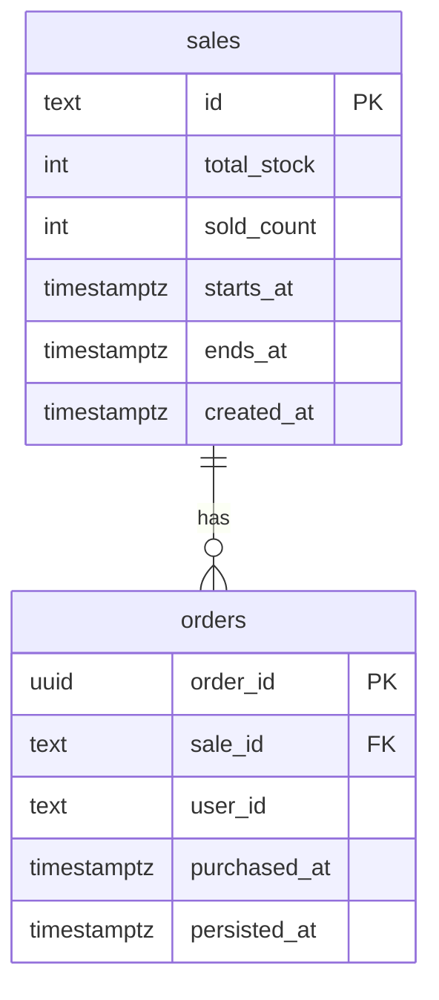

# 4. Data model

> **In short:** Redis holds the live sale and decides purchases. RabbitMQ holds each new order until it is saved. PostgreSQL holds the permanent record.

## Redis: live state

| Key                      | Type | Content                                                                                             | Written by                              |
| ------------------------ | ---- | --------------------------------------------------------------------------------------------------- | --------------------------------------- |
| `flash-sale:{id}:sale`   | Hash | `startsAt`, `endsAt` (epoch ms), `totalStock`, `remainingStock`, plus `paused` during recovery only | Bootstrap/recovery job, purchase script |
| `flash-sale:{id}:buyers` | Hash | `userId` → `{ "orderId", "purchasedAt" }`                                                           | Purchase script, recovery job           |

- **Rule that always holds:** `remainingStock` + number of buyers = `totalStock`.
- **Size:** at most `totalStock` buyers, because losing attempts write nothing.
- **The `{id}` part** is a Redis Cluster _hash tag_. It keeps all keys of one sale on the same node, which the script needs because it touches both keys at once.
- **Durability:** Redis syncs every write to disk before replying (`appendfsync always`), so a normal restart loses nothing. See D7 in [Decisions](07-decisions.md).

## RabbitMQ: orders on their way to PostgreSQL

| Queue                | Kind                                           | Content                                                             | Settings                                                                                                                          |
| -------------------- | ---------------------------------------------- | ------------------------------------------------------------------- | --------------------------------------------------------------------------------------------------------------------------------- |
| `orders`             | Durable quorum queue (replicated in a cluster) | One message per order: `orderId`, `saleId`, `userId`, `purchasedAt` | Persistent messages, publisher confirms, manual consumer acks. After 10 failed deliveries a message goes to the dead-letter queue |
| `orders.dead-letter` | Durable quorum queue                           | Orders that could not be saved                                      | Monitored. The recovery job stops before rebuilding Redis while this queue is not empty, and the sale stays paused                |

- **Each message's ID is its order ID,** so a message published twice is easy to recognise.
- **The queues are declared in code.** The bootstrap job and the worker both declare them on start-up, which is safe because declaring is idempotent.

## PostgreSQL: permanent record

- `UNIQUE (sale_id, user_id)` enforces "one per user" a second time, independently of Redis.
- `sales` also checks `total_stock >= 0` and `ends_at > starts_at`. Deleting a sale deletes its orders (`ON DELETE CASCADE`), which only the demo reset does.
- `order_id` is the primary key, so saving the same order twice changes nothing.
- `sold_count` has the rule `CHECK (sold_count <= total_stock)` and is increased in the same transaction as the insert. It is a last guard against overselling. See [Consistency and recovery](06-consistency-and-recovery.md).
- `purchased_at` comes from Redis and `persisted_at` from PostgreSQL. The difference shows how far behind the workers are.

## Lifecycle

| Step                            | When                                                              | What happens                                                                                                                                                                                                                                                                                                                                                                                                                                      |
| ------------------------------- | ----------------------------------------------------------------- | ------------------------------------------------------------------------------------------------------------------------------------------------------------------------------------------------------------------------------------------------------------------------------------------------------------------------------------------------------------------------------------------------------------------------------------------------- |
| **Preparation** (bootstrap job) | Every start-up, and in production also 10 minutes before the sale | Creates the tables and the sale (first time only), and the RabbitMQ queues. Adds the buyers PostgreSQL knows and Redis lacks, keeps every reservation Redis already has (a confirmed order may still be on its way), and sets `remainingStock` = `totalStock` − buyers. If Redis came back empty although orders exist, or a recovery did not finish, it runs the recovery procedure instead. Then it reconciles. Safe to run any number of times |
| **During the sale**             | Between `startsAt` and `endsAt`                                   | Redis decides, orders travel through RabbitMQ, and workers save them into PostgreSQL                                                                                                                                                                                                                                                                                                                                                              |
| **Reconciliation**              | At `endsAt`                                                       | Publishes any reservation that has no order record yet. See [Infrastructure](10-infrastructure.md#scheduling) for what triggers it                                                                                                                                                                                                                                                                                                                |
| **Recovery**                    | Only after Redis loses data                                       | See [Consistency and recovery](06-consistency-and-recovery.md)                                                                                                                                                                                                                                                                                                                                                                                    |
| **Reset**                       | Demos and stress tests only                                       | Deletes buyers, orders and queued messages, restarts the sale with full stock, and refreshes the sale status cached at the CDN                                                                                                                                                                                                                                                                                                                    |

- **Stock is never reset blindly outside demos.** Preparation always computes it from the buyers in Redis and the orders in PostgreSQL. A reset after real sales would sell the same units again.
- **There is no clean-up step after the sale.** Redis holds at most `totalStock` buyers, and "check my purchase" still reads them once the sale is over.

---

Previous: [3. Purchase flow](03-purchase-flow.md) · Next: [5. API](05-api.md)
