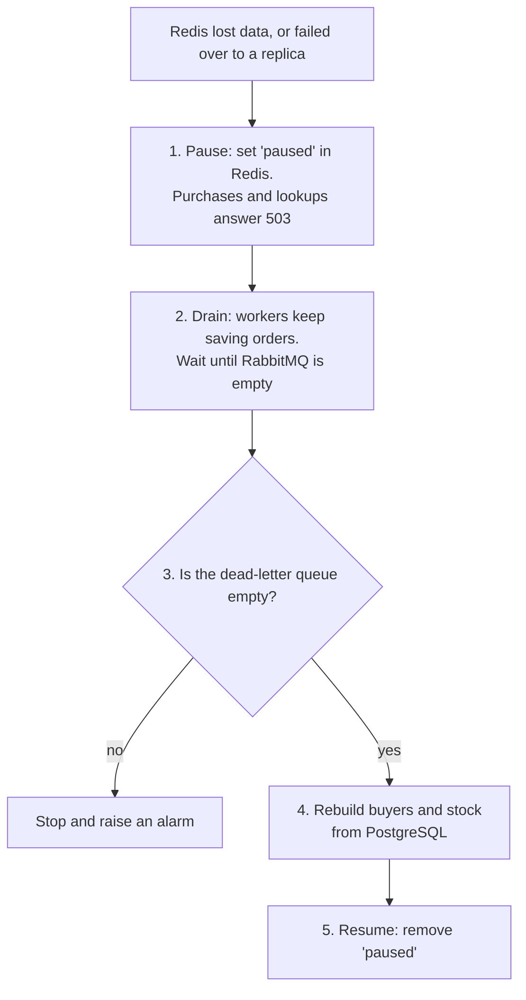

# 6. Consistency and recovery

> **In short:** during the sale only Redis decides, and nothing is ever counted from PostgreSQL or RabbitMQ on the request path. PostgreSQL catches up in the background. If Redis ever loses data, we pause the sale, let RabbitMQ drain into PostgreSQL, rebuild Redis from PostgreSQL, and resume.

## Who holds the truth

| Data                                   | Source of truth                              | Consistency                                          |
| -------------------------------------- | -------------------------------------------- | ---------------------------------------------------- |
| Remaining stock and buyers             | Redis                                        | **Strong.** Every decision sees the latest state     |
| The user's answer and "did I get one?" | Redis                                        | **Strong.** Users see their own purchase immediately |
| Order records                          | PostgreSQL                                   | **Eventual.** Normally milliseconds behind           |
| Stock number on screen                 | Redis, through a 0.5 s cache and 2 s polling | **Eventual.** Up to a few seconds old                |

"Eventual" means the data is guaranteed to arrive, just not instantly. It does not mean "maybe".

## Why we never add up PostgreSQL and RabbitMQ to decide

- **RabbitMQ knows how many messages it holds, not who the buyers are.** "One per user" needs the buyers, not just a number.
- **Two counts from two systems that keep changing cannot be read atomically.** By the time we read the second number, the first is already out of date.
- **It would put two slower systems on the hot path.**

## When Redis and PostgreSQL disagree

Here, "remaining according to PostgreSQL" means `totalStock` minus the orders in PostgreSQL.

| Case                                     | When it happens                                                         | Effect                             | Handling                                                                                                               |
| ---------------------------------------- | ----------------------------------------------------------------------- | ---------------------------------- | ---------------------------------------------------------------------------------------------------------------------- |
| **Redis shows less remaining**, briefly  | Orders are still on their way, in RabbitMQ or in a worker               | None, because those units are sold | Nothing to do. PostgreSQL catches up                                                                                   |
| **Redis shows less remaining**, for good | An unconfirmed reservation: the API crashed, or RabbitMQ did not answer | Looks like a false "sold out"      | Completed, never cancelled: published again on retry and at the end of the sale ([Purchase flow](03-purchase-flow.md)) |
| **Redis shows more remaining**           | Only if Redis lost data: a lost disk, or failover to a lagging replica  | **Overselling**                    | The recovery procedure below, plus the database guard                                                                  |

The third case cannot happen in normal operation. Taking a unit and recording the buyer happen in one atomic script, and `appendfsync always` means a restart loses nothing.

## Recovery procedure

1. **Pause.** The recovery job sets `paused` in Redis, and the purchase script answers `sale_paused` (503). The pause must be explicit: after a failover, Redis still holds data, but it may be stale.
2. **Drain.** Workers keep moving orders from RabbitMQ to PostgreSQL; they do not need Redis. The job waits until no order is in flight, meaning none waits in the queue and none is held by a worker. Shortcut: if PostgreSQL already holds `totalStock` orders, the job stops waiting. See "How the job knows the queue is drained" below.
3. **Check the dead letters.** Orders in the dead-letter queue are not in PostgreSQL. If the job ignored them, it would count too few sold units and could oversell. So when the queue is not empty, the job stops and raises an alarm.
4. **Rebuild.** buyers = every order in PostgreSQL, and `remainingStock` = `totalStock` − number of orders.
5. **Resume.** The job removes `paused`, and the sale continues.

If the job cannot finish, it exits with an error and leaves the sale paused. That happens when PostgreSQL is down too, when the queue does not drain within `DRAIN_TIMEOUT_MS` (5 minutes, for example because no worker runs), or when dead letters are waiting. An operator fixes the cause and runs it again; the next bootstrap also runs it, because it finds the sale still paused. **Correctness wins over availability.** This is a rare event.

**Why the result is correct:**

- **Every order a user was told about is counted.** RabbitMQ confirmed it before the user heard "you got it", so once the queue is empty it is in PostgreSQL.
- **Releasing an unconfirmed reservation is safe.** It was never promised to anyone: the user got a 503 or no answer at all.
- **If a message got through but its confirm was lost,** the order still reaches PostgreSQL and is rebuilt. The user sees it via "check my purchase".

**What triggers recovery:**

| Event                              | Recovery needed?                                                                                                 |
| ---------------------------------- | ---------------------------------------------------------------------------------------------------------------- |
| Redis restarts normally            | No. `appendfsync always` keeps the data intact                                                                   |
| Redis comes back empty (lost disk) | Yes. The sale data is missing, so the API already answers 503. Running the bootstrap job detects it and recovers |
| Failover to a replica              | Yes. Replicas can lag behind, so treat it as data loss                                                           |

### How the job knows the queue is drained

Messages that wait in the queue are counted exactly, in real time, over AMQP. Messages a worker holds without having acknowledged them only show up in the management API, and its numbers are **sampled**. During testing, a quorum queue that held 2 messages still read 0 there for about 8 seconds with default settings. Trusting the first zero would rebuild Redis without those orders, and units could be sold twice.

So the job relies on one fact instead: **once the sale is paused, the number of orders in flight can only go down.**

- **Nothing new is published,** except by purchases decided just before the pause. Those are bounded by the 2 s publish timeout.
- **Acks and dead-lettering remove messages, and a requeue moves a message without adding one.**

The job therefore ignores all readings for a settle period after the pause (`DRAIN_SETTLE_MS`). That period must be longer than the age of the sampled counts plus the publish timeout. After it, the first reading of zero means the queue really is drained. The reconcile job skips publishing while the sale is paused, so it cannot refill the queue during recovery.

| Setting                                   | Local (Docker Compose) | RabbitMQ defaults (e.g. Amazon MQ) |
| ----------------------------------------- | ---------------------- | ---------------------------------- |
| Statistics interval and quorum queue tick | 1 s each               | 5 s each                           |
| `DRAIN_SETTLE_MS`                         | 5 s                    | About 15 s                         |

## Reconciliation at the end of the sale

When the sale ends (and whenever the bootstrap job runs), every buyer in Redis without an order record is published to RabbitMQ again. This completes reservations whose confirm never arrived. Duplicates are skipped by the worker.

- **Locally,** a small `scheduler` service (from the `jobs` app) stands in for EventBridge Scheduler. It runs all the time and checks every 15 seconds: once `endsAt` has passed it runs reconciliation, and once more 5 minutes later. The `reconcile` command runs it by hand.
- **In production,** an EventBridge Scheduler one-time schedule at `endsAt` triggers it. See [Infrastructure](10-infrastructure.md#scheduling).

## Last guard in PostgreSQL

`sales.sold_count` is increased in the same transaction as each insert, under the rule `CHECK (sold_count <= total_stock)`. If an oversell ever slipped through, for example through a recovery mistake, the insert would fail and the message would end up in the dead-letter queue with an alarm. **An oversell can never happen silently.**

## What we monitor

- **Order lag:** `persisted_at − purchased_at`.
- **RabbitMQ:** queue depth, and any message in the dead-letter queue.
- **Redis buyers vs PostgreSQL orders.** If PostgreSQL ever has more, Redis lost data, and an alarm goes off.

---

Previous: [5. API](05-api.md) · Next: [7. Decisions](07-decisions.md)
