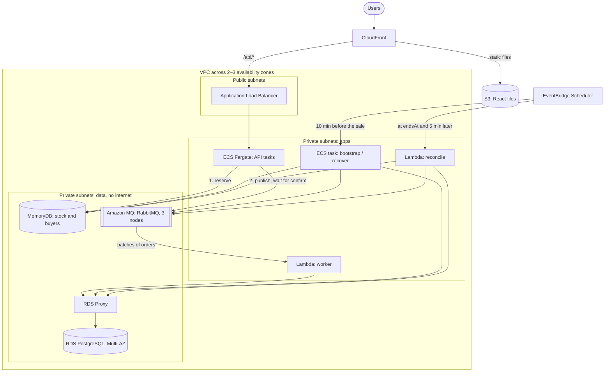

# 12. Cloud deployment (AWS)

> **In short:** the assignment does not ask for a deployment, so nothing is deployed. This document describes how the system would run on AWS. [`infra/aws/`](../infra/aws) contains the matching infrastructure-as-code (AWS CDK, TypeScript) as a **design**: it has not been deployed or tested.

## Architecture



## Components

| Part                  | AWS service                         | Production setup                                                                                                                                                                                                                                                               | If an availability zone fails                                                          |
| --------------------- | ----------------------------------- | ------------------------------------------------------------------------------------------------------------------------------------------------------------------------------------------------------------------------------------------------------------------------------ | -------------------------------------------------------------------------------------- |
| CDN and frontend      | CloudFront + S3                     | React files come from S3. `/api/*` goes to the load balancer, and `GET /api/sale` is cached at the edge for 0–30 s, following the API's `Cache-Control`, which depends on the sale's phase and remaining stock (D16). After `reset` or `recover`, the jobs task invalidates it | CloudFront is global and unaffected                                                    |
| Load balancer         | Application Load Balancer           | Spans every zone and checks `/health/ready`                                                                                                                                                                                                                                    | Keeps serving from the other zones                                                     |
| API                   | ECS Fargate                         | 1 vCPU and 2 GB per task, 2 to 20 tasks, scaled out 10 minutes before each sale                                                                                                                                                                                                | Tasks in the failed zone are replaced in the others                                    |
| Worker                | Lambda                              | Reads `orders` from Amazon MQ in batches of 100, at most 5 instances at once, connects through RDS Proxy                                                                                                                                                                       | Lambda already runs across zones                                                       |
| Reconcile             | Lambda                              | Started by EventBridge Scheduler at `endsAt` and 5 minutes later                                                                                                                                                                                                               | Same as the worker                                                                     |
| Bootstrap and recover | ECS task (`jobs` app)               | Bootstrap runs at deploy time and 10 minutes before each sale. Recover is started by an operator                                                                                                                                                                               | —                                                                                      |
| Redis                 | MemoryDB (Valkey, Redis-compatible) | One shard: a primary plus a replica in another zone, with TLS and its own user                                                                                                                                                                                                 | The replica takes over without losing an acknowledged write (multi-AZ transaction log) |
| RabbitMQ              | Amazon MQ, cluster                  | 3 nodes across zones, quorum queues                                                                                                                                                                                                                                            | The 2 remaining nodes keep the queue running                                           |
| PostgreSQL            | RDS Multi-AZ + RDS Proxy            | Standby in another zone, 7 days of backups, deletion protection                                                                                                                                                                                                                | Fails over in 1–2 minutes. Orders wait in RabbitMQ meanwhile                           |
| Secrets               | Secrets Manager                     | Generated passwords for MemoryDB, Amazon MQ and PostgreSQL                                                                                                                                                                                                                     | —                                                                                      |
| Scheduling            | EventBridge Scheduler               | One schedule group. Each sale's schedules are created by the `jobs` app                                                                                                                                                                                                        | —                                                                                      |
| Monitoring            | CloudWatch + SNS                    | Logs from every app, and alarms sent to the on-call channel                                                                                                                                                                                                                    | —                                                                                      |

### Why the worker can be serverless but the API cannot

|             | Worker on Lambda                                                                        | API on Lambda                                          |
| ----------- | --------------------------------------------------------------------------------------- | ------------------------------------------------------ |
| Load        | Small and bursty: at most `stock` orders in a few seconds, then nothing                 | Thousands of requests in the same second               |
| Cold starts | Only delay saving to PostgreSQL, so users never notice                                  | Thousands at once, exactly when the sale opens         |
| Connections | Bounded concurrency plus RDS Proxy (PgBouncer's part locally, D15) keep PostgreSQL safe | Thousands of new Redis connections at the worst moment |
| Verdict     | **A good fit**                                                                          | **Not a fit.** Containers, scaled out before the sale  |

The volume of a flash sale is unpredictable, but its **timing is known in advance**. That is why scheduled scaling beats reactive autoscaling for the API.

## A purchase, in production

1. The browser calls CloudFront, which forwards `/api/purchases` to the load balancer, which passes it to an API task.
2. The API runs the reserve script on MemoryDB: one round trip inside the VPC.
3. The API publishes the order to Amazon MQ and waits for the confirm. By then the order is stored on a majority of the three nodes.
4. The API answers `201`, back through the load balancer and CloudFront.
5. Amazon MQ hands the order to the worker Lambda, which saves it through RDS Proxy into PostgreSQL. The message is acknowledged after the commit.

## Network and security

- **Three subnet tiers:**
  - **Public:** the load balancer and the NAT gateways.
  - **Private app:** API tasks, Lambdas and jobs, with outbound access through NAT to reach AWS APIs.
  - **Private data:** MemoryDB, Amazon MQ and RDS, with no route to or from the internet.
- **Security groups allow only these connections:**

| From              | To                     | Port         |
| ----------------- | ---------------------- | ------------ |
| Load balancer     | API tasks              | 3000         |
| API, jobs         | MemoryDB               | 6379 (TLS)   |
| API, worker, jobs | Amazon MQ              | 5671 (AMQPS) |
| Worker, jobs      | RDS Proxy → PostgreSQL | 5432 (TLS)   |

- **The API cannot reach PostgreSQL, and the worker cannot reach Redis.** The network enforces the same boundaries as the code (see [Code structure](11-code-structure.md)).
- **Passwords live in Secrets Manager.** ECS injects them as environment variables, and Lambdas read them at start-up. No secret is stored in code or images.
- **Each app has its own IAM role** with only the permissions it needs. For example, only the `jobs` app may create schedules and scaling actions.

## Scaling

| Part           | How it scales                                                                                                                                                                                                                 |
| -------------- | ----------------------------------------------------------------------------------------------------------------------------------------------------------------------------------------------------------------------------- |
| API            | **Scheduled:** out to the sale size 10 minutes before `startsAt`, and back in after `endsAt`. The `jobs` app creates these actions for each sale. **Reactive:** CPU target of 60%, between the minimum and maximum task count |
| Worker         | Lambda adds instances as batches arrive, capped at 5 to protect PostgreSQL                                                                                                                                                    |
| MemoryDB       | A larger node type. More shards only help with many sales at once, because one sale is one hash tag on one shard                                                                                                              |
| Amazon MQ, RDS | A larger instance type, if ever needed. They only handle at most `stock` messages and rows per sale                                                                                                                           |

## Environments

|                     | dev              | staging           | prod              |
| ------------------- | ---------------- | ----------------- | ----------------- |
| Availability zones  | 2                | 2                 | 3                 |
| API tasks (min–max) | 1–2              | 2–6               | 2–20              |
| MemoryDB            | 1 node           | Primary + replica | Primary + replica |
| Amazon MQ           | Single instance  | 3-node cluster    | 3-node cluster    |
| RDS                 | Single-AZ, small | Multi-AZ          | Multi-AZ          |
| Deletion protection | No               | No                | Yes               |

The sizes are starting points, to be confirmed with load tests in staging ([`infra/aws/lib/config.ts`](../infra/aws/lib/config.ts)).

## Deployment pipeline

```
push → tests (unit + integration) → build images → push to ECR
     → cdk deploy staging → smoke test → manual approval → cdk deploy prod
     → run the bootstrap task (schema migrations, Redis in sync with PostgreSQL)
```

- **GitHub Actions authenticates to AWS with OIDC,** so no access keys are stored.
- **No deploys while a sale is running.** The pipeline checks the sale window first.
- **Rollback means redeploying the previous image tags** (the ECS task definition and the Lambda version).
- **Schema changes are backwards compatible,** because old and new API tasks run side by side during a deploy.

## Infrastructure as code (`infra/aws/`)

| Stack   | Contents                                                                                          | Changes                                       |
| ------- | ------------------------------------------------------------------------------------------------- | --------------------------------------------- |
| Network | VPC, subnets, security groups                                                                     | Rarely                                        |
| Data    | MemoryDB, Amazon MQ, RDS + RDS Proxy, secrets                                                     | Rarely. Protected from deletion in production |
| App     | API on ECS + load balancer, Lambdas, jobs task, scheduler group and role, S3 + CloudFront, alarms | On every release                              |

**The infrastructure code only describes what never changes.** A sale's times are data, so its schedules and scaling actions are created at runtime:

| Defined in `infra/aws/` (static)                                         | Created by the `jobs` app for each sale (dynamic)                                                   |
| ------------------------------------------------------------------------ | --------------------------------------------------------------------------------------------------- |
| The schedule group, its IAM role, the reconcile Lambda and the jobs task | One-time schedules: bootstrap 10 minutes before the sale, reconcile at `endsAt` and 5 minutes later |
| The API's minimum and maximum task count                                 | Scheduled scaling actions: out before the sale, in after it                                         |

**How it would be checked without deploying:** `cdk synth` produces the CloudFormation templates. Assertion tests would then pin the rules that matter, such as quorum queues, Multi-AZ RDS, a bounded worker concurrency, and deletion protection on the data stack.

**Simplifications in the design:**

- CloudFront reaches the load balancer over HTTP. A real setup needs a domain and an ACM certificate to use HTTPS.
- The Lambda entry files are referenced but not built, and neither is the jobs' CloudFront invalidation (locally the jobs refresh nginx's cache instead).
- The "orders missing in PostgreSQL" alarm expects a metric that the reconcile job would publish. Locally, the job only logs it.

## Not covered

- **More than one region.**
- **WAF, rate limiting and bot protection.** These are out of scope (see [Decisions](07-decisions.md)).

---

Previous: [11. Code structure](11-code-structure.md) · Back to the [index](README.md)
